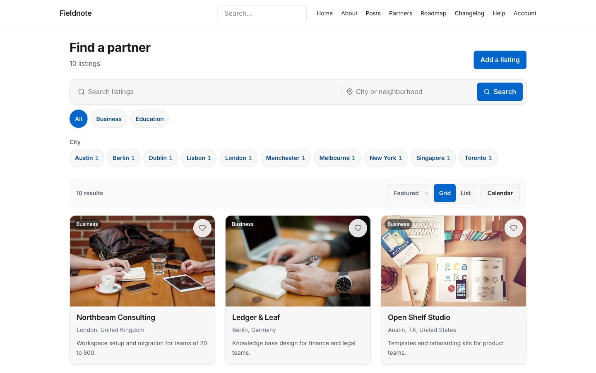
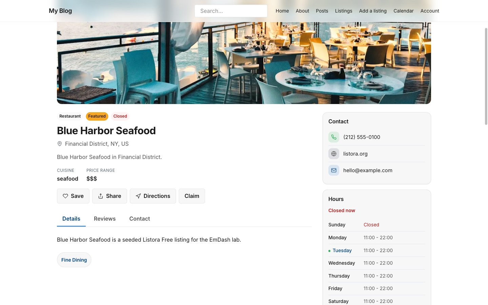
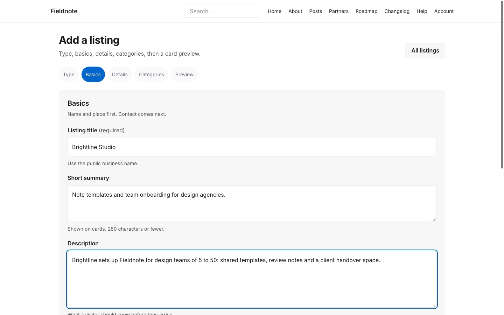
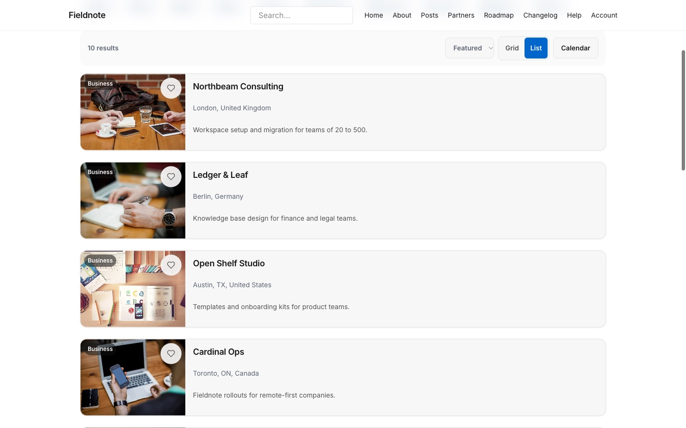
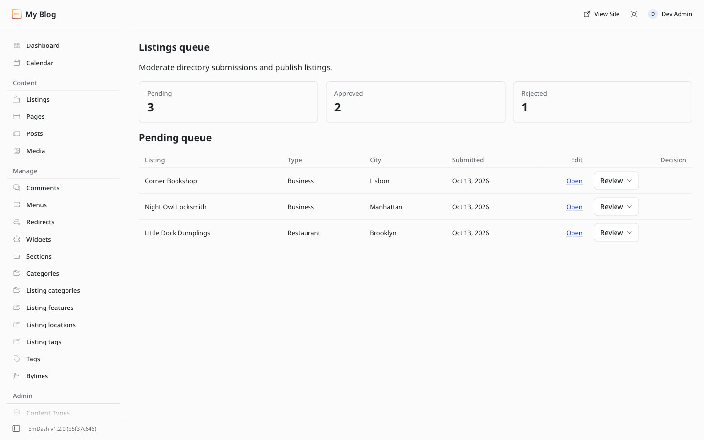

<h3 align="center">A moderated directory for your EmDash site</h3>

Turn your site into a directory of places, or of software. Visitors search and browse on a map. Members add listings, review, save and claim. You approve everything before it goes live.

  <a href="https://plugins.emdashcms.com/plugins/@vapvarun.bsky.social/listora"><b>Install from the EmDash registry</b></a>
  &nbsp;·&nbsp;
  <a href="docs/website/README.md">Read the docs</a>
  &nbsp;·&nbsp;
  <a href="CHANGELOG.md">What's new</a>

## Who it is for

A local guide, a business association, a software catalogue or any site that lists things people want to find. If you want a directory on your EmDash site that you moderate yourself, Listora is for you.

## What you get

**For you, the site owner**

- **Listing types you edit.** Ten local types plus Software, and your own, each with its own fields. Types without a place drop the map and address.
- **A Software type** for plugins, skills, agents, MCP servers and apps, with an Install box and live GitHub stars.
- **Moderation in the dashboard.** Queues for everything that waits, a dashboard card and Settings.
- **Import and export.** CSV in as drafts, 100 rows at a time, and out.
- **Photos and optional expiry** for each listing.

**For visitors and members**

- **Search and browse** by keyword and place, with filters, grid and list views, a featured row and a map.
- **Submit a listing** with a five-step form, a duplicate check and an hourly limit.
- **Reviews and claims.** One review per member per listing, and an owner can claim their business. Both wait for your approval.
- **Owner tools.** Owners edit their listing, add photos, read messages, reply to reviews and renew. Edits, photos and replies wait for you.

  
  

  
  

## Get started

1. In your EmDash dashboard, open **Registry**, search for **Listora** and install it. Your site needs a sandbox runner first, and the [install guide](docs/website/getting-started/install.md) shows how.
2. Copy the site pages into your site once, with the one command in the guide, then add the menu links it prints.
3. Open **Listora, Get started**, add your first listing and approve it.

## Good to know

- **Guests browse and message.** Adding, reviewing, saving and claiming need a signed-in account.
- **Everything waits for approval by default.** You can turn approval off in Settings. Owner edits, photos and replies always wait.
- **Email is optional.** Two short notices to owners, with no visitor text, each can be turned off.
- **On Cloudflare,** EmDash 1.4 or later is needed. See the [install guide](docs/website/getting-started/install.md).
- **Free, with no paid version.**

## Docs

- [Docs home](docs/website/README.md)
- [Install](docs/website/getting-started/install.md)
- [Listing types](docs/website/features/listing-types.md)
- [Directory and search](docs/website/features/directory.md)
- [Reviews and claims](docs/website/features/reviews-claims.md)
- [Settings](docs/website/settings/plugin-settings.md)
- [Wording](docs/website/customize/wording.md)
- [FAQ](docs/website/faq/faqs.md) and [Troubleshooting](docs/website/troubleshooting/common.md)

## More from Wbcom Designs for EmDash

[Learnomy](https://github.com/wbcomdesigns/emdash-learnomy) courses · [WB Reviews](https://github.com/wbcomdesigns/emdash-reviews) · [WB Polls](https://github.com/wbcomdesigns/emdash-polls) · [Product Roadmap](https://github.com/wbcomdesigns/emdash-roadmap) · [KnowX](https://github.com/wbcomdesigns/emdash-knowx)

Found a bug or have an idea? [Open an issue](https://github.com/wbcomdesigns/emdash-listora/issues). Want to build on Listora? Start with [CONTRIBUTING.md](CONTRIBUTING.md).

MIT licence. Made by [Wbcom Designs](https://wbcomdesigns.com).
