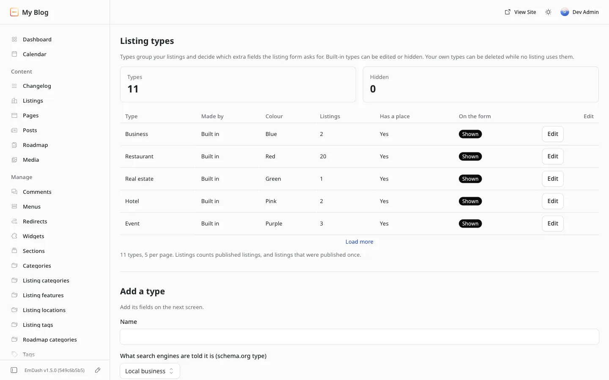
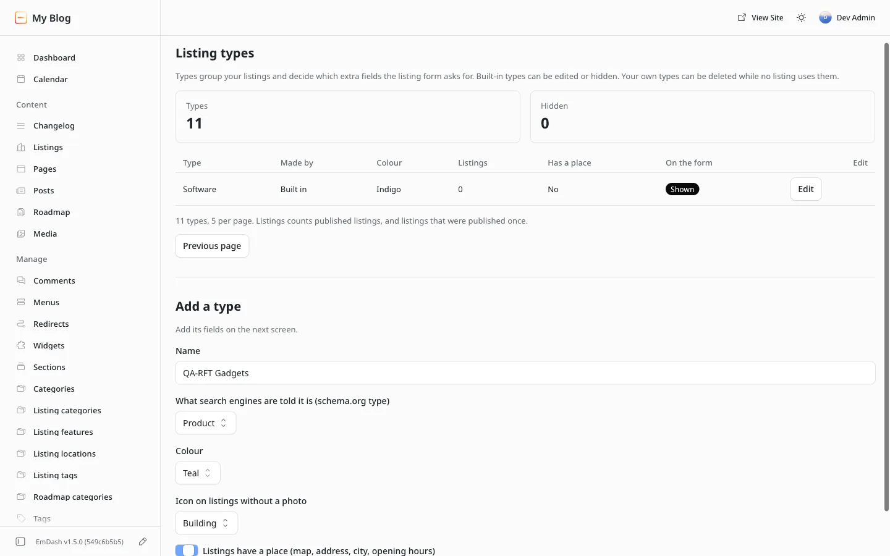
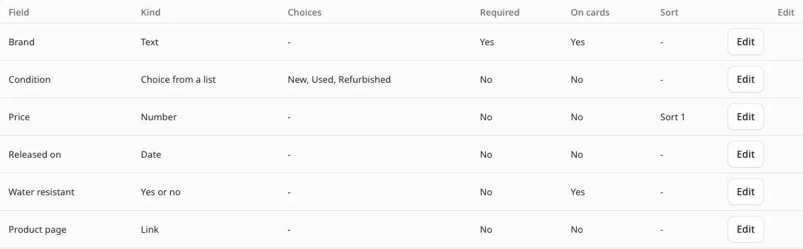
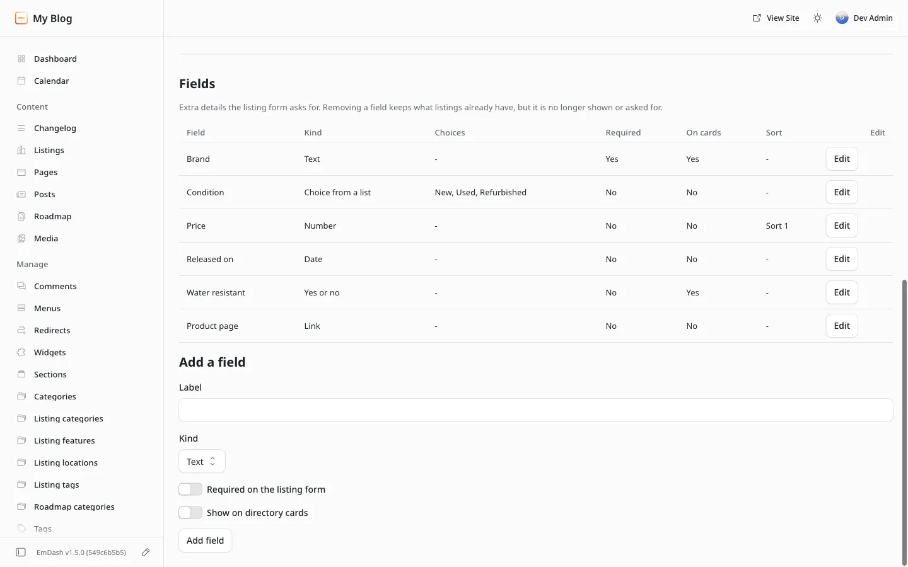

# Listing types

**Included in Free**

Open it from the admin menu: Listora, **Listing types**. Every listing has one type. The type gives the listing its name on cards, its colour, the icon shown when it has no photo, what search engines are told it is, whether it has a place, and the extra fields the listing form asks for.

Listora comes with eleven built-in types: Business, Restaurant, Real estate, Hotel, Event, Job, Healthcare, Education, Place, Classified and Software. You can edit and hide them, and add your own.

## The list

The page opens with two counts: **Types** and **Hidden**. The list shows five types to a page, with **Next** and **Previous page**. Each row says:

| Column | What it shows |
| --- | --- |
| Type | The name visitors see. It is also the button that opens the type |
| Listings | Published listings of this type, and listings that were published once |
| Place | Yes when listings of this type have a map, address, city and opening hours |
| On the form | Shown (offered for new listings) or Hidden |
| Made by | Built in, or Your own |

Press a type's name to open it. On a phone the name comes first, so the way in is on screen without scrolling sideways. The type's colour shows on its form.

## Add a type

The form under the list asks for:

- **Name**. Two types cannot share a name.
- **What search engines are told it is**, from a list (Local business, Restaurant, Event, Software and so on).
- **Colour**, from a list of named colours.
- **Icon on listings without a photo**, from a list of icons.
- **Listings have a place**. Turn it off for things with no address, such as software or online services.

Press **Add type**. The type opens, ready for its fields. A site can add up to 40 types of its own.

## Edit a type

The type's page has the same form with **Save type**, then:

- **Hide from the form** or **Show on the form**. A hidden type is not offered for new listings. Listings that already have it keep it and still show it.
- **Delete type**, for your own types only. It asks once. Listora refuses while any listing of the type exists, published or draft, and refuses the type that is the default for new listings (change the default in Settings first). Built-in types can be hidden, not deleted.

## Fields

Below the type form is the table of the type's extra fields, and **Add a field**. The table shows each field's label, kind, choices, whether it is required and shown on cards, its sort or filter, and **Edit**.

Add one field per press of **Add field**:

- **Label**. Two fields of one type cannot share a label, and a label that matches a standard spreadsheet column (Title, City and the rest) is refused, so every field gets its own CSV column.
- **Kind**: Text, Number, Choice from a list, Link, Date, or Yes or no.
- **Choices, one per line**, for a choice field. At least two, up to 30.
- **Required on the listing form**.
- **Show on directory cards**.
- **Visitors can sort by it**, for a number or date field: Sort 1, Sort 2 or Sort 3. Each sort can belong to one field of the type. Listora refuses a sort another field already uses and names that field. The sorts show in the directory once a visitor picks the type.
- **Visitors can filter by it with chips**, for a choice field. One field per type: its choices become chips in the directory once a visitor picks the type. Listora refuses a second one and names the field that has it. Software's **What it is** is its chip field.

Press **Edit** on a field to change it, or to remove it with **Remove field** (it asks once). A removed field's values stay on the listings: they are no longer shown or asked for. A type can have up to 30 fields.

When you save a field's sort or chips, Listora starts filling every listing's values straight away, a hundred listings a run, so a sort or chip is ready within hours on a large directory without waiting for the hourly check.

## Types without a place

Turn off **Listings have a place** on a type for things with no address: software, online services, remote jobs. Listings of that type then have, on every screen:

- no city, address, state, country or map position on the submit and edit forms, and none stored, even from a CSV import;
- no map, address, opening hours, directions, or Open and Closed on the listing page;
- no location box, city chips or map in the directory once the type is picked;
- no address or position in what search engines are told.

Turning the switch back on shows again whatever a listing stored before it was turned off.

## Software

Software is one built-in type for plugins, skills, agents, MCP servers, apps, libraries and themes. It has no place: no map, address, city or opening hours. Its fields:

| Field | Kind | Where it shows |
| --- | --- | --- |
| What it is | Choice: Plugin, Skill, Agent, MCP server, App, Library, Theme | Card badge, page badge |
| Works with | Choice: WordPress, EmDash, Claude Code, Cursor, VS Code, npm, Python, Any | Card badge, page badge |
| Repository | Link | The main button on the card and the page |
| Homepage or docs | Link | **Docs** button on the page |
| Install command | Text | The **Install** box on the page, with **Copy** |
| Version | Text | Card and page, next to the last release |
| License | Choice: MIT, GPL, Apache, BSD, Proprietary, Other | Card badge, page badge |
| Price | Choice: Free, Freemium, Paid | Card badge, page badge |
| Open source | Yes or no | Page badge |
| Stars or installs | Number, Sort 1 | Card and page |
| Last release | Date, Sort 2 | Card and page, as "2 weeks ago" |
| Released | Date, Sort 3 | Details |

### The card

A Software card shows the logo (the listing's photo) or the type's icon, the name, a one-line summary (the excerpt), badges for What it is, Works with, License and Price, the rating, stars or installs, the version and how long ago it was released, a **View on GitHub** (or **Repository**) button, and the heart to save it.

<!-- Screenshot for the walk: Software cards in the directory at 1440 and 390 -->

### The listing page

- **Header**: the badges, stars or installs, the version and last release, then **View on GitHub** or **Repository**, **Docs**, **Save**, **Share**, **Claim** and **Report**. **Report** opens the message form with a first line written; the message reaches Messages in the admin, and the owner when the listing has one.
- **Install**: the install command in a code box with **Copy**. The page never runs it. When the browser cannot copy, the line is selected so the visitor can copy it by hand.
- **About**: the listing's description.
- **Screenshots**: the listing's photos, from the same photo feature as every type (photos an owner sends, or gallery rows added in the editor).
- **Details**: every filled-in field.
- **Reviews**, as on every listing.
- **Poll**: when the WB Polls site kit is on the site, the poll attached to the listing, its content type or the site shows here. Without WB Polls nothing shows.
- **Maintained by**: the owner's name once the listing is claimed, or the claim form.

<!-- Screenshot for the walk: a Software listing page at 1440 and 390 -->

### Live GitHub numbers

When the repository is on github.com, the visitor's browser asks GitHub's public API for the stars and, on the listing page, the latest release tag and date, and shows them in place of the stored values. Listora itself makes no outside request and needs no network permission. Each browser asks once per session. If GitHub cannot be reached or has had too many requests from that visitor (60 an hour without signing in), the page keeps the stored values and shows no error. Keep the stored fields filled in: they are what search engines and visitors without GitHub see.

### What search engines are told

A Software listing page carries schema.org `SoftwareApplication` data, added by the plugin to the page head:

| Property | From |
| --- | --- |
| `name`, `description` | The title and excerpt (or the page's SEO description) |
| `applicationCategory` | What it is: `DeveloperApplication` for Plugin, Skill, Agent, MCP server and Library, `DesignApplication` for Theme. App has no single fit, so none is given |
| `applicationSubCategory` | What it is, as written |
| `operatingSystem` | Works with, left out for Any |
| `softwareVersion` | Version |
| `offers` | An offer at price 0 for Free and Freemium. Listora stores no price for Paid, so none is given |
| `aggregateRating` | The listing's published reviews, once it has one |
| `url` | Homepage or docs, else the repository, else the listing page |
| `image` | The listing's share image |

Google shows a software rich result only with a rating and a price, so a listing needs at least one review, and Free or Freemium, to qualify. Other types keep their own structured data, unchanged.

### Links on member listings

On a listing a member manages (added or claimed), the Repository, Docs, website and detail links carry `rel="nofollow ugc"`, so search engines know a member wrote them.

### Sample listings

**Load sample directory** adds three made-up Software listings (Trailmark MCP Server, Quillpad and Ledgerline) at example addresses, one with two reviews. Their GitHub address does not exist, so they show their stored numbers.

## Two admins at once

Each save carries the version of the type you were shown. If someone else saved the type after your page loaded, your save is refused with **changed since this page loaded**, and the page shows what is saved now. Check it and save again. Nothing is overwritten without you seeing it.
